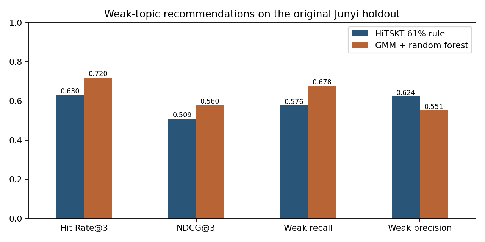

# Junyi weak-topic recommendations with GMM and random forest

On the original Junyi holdout, the forest put at least one genuinely weak topic in the first three recommendations for **5,542 of 7,702** learners with a weak topic. The original HiTSKT rule did so for **4,853**. The forest reached more learners and issued more false flags. When both methods filled the same number of recommendation slots for each learner, HiTSKT achieved the higher NDCG.

| Held-out metric | HiTSKT 61% rule | GMM + random forest |
|---|---:|---:|
| Hit Rate@3 | 63.01% | 71.96% |
| NDCG@3 | 0.5093 | 0.5798 |
| Learners with observed weakness receiving an empty list | 2,150 | 1,335 |
| Weak recall across pairs | 57.64% | 67.80% |
| Weak precision across pairs | 62.40% | 55.13% |
| Weak F1 | 0.5993 | 0.6081 |
| Average precision across pairs | 0.6539 | 0.6415 |
| Weak pairs flagged | 15,184 | 17,862 |
| False weak flags | 9,148 | 14,538 |

The original holdout contains 13,039 learners, 107,197 student–skill pairs, and 26,344 observed weak pairs (later accuracy below 60%). All pairs enter the classification rows. Only learners with at least one observed weak skill enter the ranking rows. The forest flagged 2,678 additional weak pairs and 5,390 additional non-weak pairs before limiting each learner’s list to three.

## Interpreting the improvement

The GMM learned later-accuracy components centered at 41.68%, 76.25%, and 99.97% on 86,559 fitting pairs. The forest used the HiTSKT score and three practice-history features to estimate membership in the lowest component. Validation selected a forest risk cutoff of **0.33** by weak-class F1. The original 0.61 HiTSKT cutoff was selected earlier by three-class macro-F1. Comparing these frozen policies answers which recommendations each would issue; their different tuning objectives prevent attributing the whole gain to the forest or to its features alone.

The paired 95% bootstrap interval for the forest’s Hit Rate@3 improvement was **+8.23 to +9.69 percentage points**. For NDCG@3 it was **+0.0649 to +0.0765**. When both methods ranked all eligible topics and returned up to three without a flag cutoff, HiTSKT had Hit Rate@3 of **91.42%** and NDCG@3 of **0.7569**, compared with **91.05%** and **0.7468** for the forest. The forest’s operational advantage was in issuing more recommendations; the equal-length comparison gives no evidence of improved ordering.

For 90,385 of 107,197 held-out pairs the skill had no recorded attempts in the retained history window. HiTSKT still supplied a score from the learner’s broader history. This limits what topic-specific practice features can contribute and makes the retrospective population broader than a paper checklist restricted to previously attempted topics.

## Files

* [Method and reproduction commands](METHOD.md)
* [Hit Rate@3, NDCG@3 and paired intervals](ranking_results.csv)
* [Ranking with equal list lengths](ranking_without_flags.csv)
* [Weak-topic classification counts and metrics](weak_topic_metrics.csv)
* [Development cutoff search](validation_cutoffs.csv)
* [Cohort counts, model checks and input hashes](verification.json)

The scripts in this folder reproduce the development HiTSKT scores, extract pre-assessment features, and fit and evaluate the alternative recommender. The sibling Junyi_original_ranking folder provides the held-out score replay.
