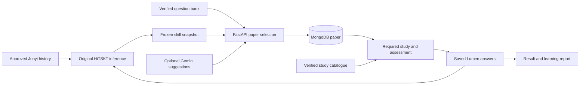

# Junyi adaptive assessment architecture

Lumen's Junyi pilot connects a Next.js student workspace to FastAPI and MongoDB. The assigned student can open their assessment, complete the required study and review their own results. A designated administrator can resolve a missing study resource with a recorded exception. The original HiTSKT checkpoint supplies estimates from verified Junyi identifiers. [Platform setup](../../docs/platform/junyi.md)

## One assessment cycle

1. FastAPI checks the signed-in account and identifies its current paper. A MongoDB unique index ensures the student has one active paper. A fresh paper uses the saved answer history, bank and stage policy. Gemini sees short candidate references and topic metadata. The allocation rules check suggestions and fill remaining slots.
2. FastAPI saves the ordered questions, shuffled option IDs, grading keys, score snapshot and study requirements before showing the checklist. Required study is limited to attempted Weak skills on that paper. Optional study covers other eligible skills in Learn. The question and answer endpoints enforce the study lock.
3. The student chooses one option at a time. FastAPI grades against the frozen key and records the grade, ordered position and request ID in MongoDB. An exact retry returns the saved result. A conflicting submission is rejected. The browser resumes from the saved question and keeps a local draft during a reload.
4. The final answer saves the actual result and fixes the analysis cutoff at completion time. The model sees a verified representative Junyi question and the student's actual outcome for each eligible app event. Progress shows the grade separately from the original-only and app-inclusive estimates. The next paper uses the applicable session window and avoids previously answered items under the default policy.

| Component | Responsibility |
| --- | --- |
| Next.js | Today, Learn, Progress, the locked checklist, the question player and the authorized operator view. |
| FastAPI | Account scope, eligibility, resource checks, locking, grading, proxy mapping and inference preparation. |
| MongoDB | Versioned papers, study audit, genuine app answers, results and snapshots. |
| HiTSKT | Correctness estimates over legal original model inputs. |
| Gemini | Optional candidate selection and ordering of independently verified lessons. |

The research baseline is a separate read-only input. The account response omits grading keys and raw history. The private review export provides reproducible evidence while the following paper's JSON contains redacted metadata and a fingerprint of the frozen items. [Verified inputs](DATASET_AND_SKILL_MAPPING.md) · [Inference limitations](INFERENCE_AND_PROXY_LIMITATIONS.md) · [Verification](TEST_RESULTS.md)
