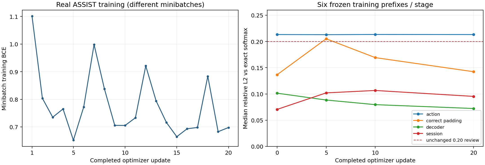

# ASSIST2017: recoverable 20-update FAVOR+ validation study

20 October 2026 UTC. Branch `research/hitskt-favor-plus-v1`, starting from `8d4175b88bb73bbf42ef220a41abada1cf6c2bf3`.

**Execution and recovery PASS: exactly 20 real Adam updates, atomic checkpoints at 5/10/20, and three fresh CUDA recovery processes with zero extra optimizer calls. Approximation REVIEW remains. GO for a separately authorized continuation to 50 total updates; NO-GO for full training.** No test-set evaluation, additional seed, hyperparameter sweep or 50/100-update stage was performed. The original failed 14-update run was preserved, not resumed.

Executed implementation commit: **`1595785e93027691bd9d913a208ab34c59a0d827`**. Prospective design commit: **`9a247ad339c5b13815ed56746c246c95dbf3159c`**. Source/data/configuration hashes and the exact sample identities are embedded in every checkpoint. Report/evidence publication SHA is recorded in Git and the final handoff; this source SHA identifies the code that actually executed.

[Machine-readable summary](assist20_recovery_20261020_v1/VERIFICATION_SUMMARY.json), [design](assist20_recovery_20261020_v1/PREDECLARED_DESIGN.json), [prepared plan](../../experiments/hitskt_favor_plus_v1/assist2017/assist20_recovery_20261020_v1/prepared_plan.json).

## 1. Resource interruption: what is established

Historical blocking PIDs **2751270, 2731414 and 2730863 remain UNKNOWN**: they exited before identity capture. The separate historical snapshot of PID2750534 showed comm=nvidia-smi but lacked enough executable/argument evidence to establish read-only behavior. It would be incorrect to retrospectively certify these events as either competing training or harmless monitoring.

A concrete **guard race was reproduced in a CPU filesystem fixture**: the old guard inspected a GPU file descriptor, then attempted to identify its owner. A trusted display query exiting between those reads became an unidentified conflict. The new guard captures UID, parent PID, start-time ticks, executable device/inode, argument fingerprint and approved option names **before** descriptors; it rechecks PID/executable identity. The literal old guard rejects the exiting-monitor fixture; the new guard retains its verified identity. [Regression proof](assist20_recovery_20261020_v1/legacy_race.log), [test source](../../tests/test_favor_plus_recoverable20.py).

Production admission allows only the actual root-owned, non-group/world-writable trusted NVIDIA binary with a complete read-only option parse. Unknown binaries/arguments, reset/configuration options, spoofed names, PID reuse, changed executables, inaccessible owners and compute workers remain blocking. Raw arbitrary argv/environment values are not stored. The new scanner is used only by this versioned study; historical guards and scientific model code remain unchanged. Its additional approved forms include explicit read-only query/id arguments, not a blanket exemption by name.

This real run positively identified **20 distinct trusted read-only nvidia-smi PIDs across 41 synchronous boundary observations**. They were ordinary display queries with no options, executable `/usr/bin/nvidia-smi`, root-owned binary SHA256 `a7d6645d5d4554ce7f5e7ae68cef9fb32d21721eaa2c271f7a58ef6c21039263`. No unknown/compute holder was admitted. No workload was stopped, signaled or restarted. These observations explain the present monitoring activity and validate the practical fix; they do not recover the identities of old PIDs. Detailed PID/UID/start-time/executable evidence is in the summary and per-stage monitor_event JSONs.

## 2. GPU authorization and preflight

The user's existing H100 research allocation remains the authority. Kubernetes403 is a visibility limitation, not a denial or a reason to request permission again. No administrator/scheduler reservation evidence is invented, and no conflicting reservation is overridden. [Authorization](assist20_recovery_20261020_v1/OWNER_AND_STUDY_AUTHORIZATION.md), [admission](assist20_recovery_20261020_v1/resource_admission.json).

- Actual UUID **MIG-d2fcfd79-720e-5218-82c9-0a132be68920**, H10080GB parent **GPU-5a568e3c-e96c-169f-b063-f4478340ff51**, MIG **3g.40gb**. Exact exposed/visible device matched. NVML compute list empty before CUDA and before each planned process. Initial MIG total42,278,584,320 bytes/free42,238,869,504 bytes.
- LightSAKT2 remained stopped with persistent USER_TRAINING_HOLD_ACTIVE and unchanged hold hash. No Light or DKT artifact/configuration/scheduler change. Container RAM limit90GiB; inherited OOM count2 remained unchanged. Checks are limited to visible process/NVML metadata and the owner's allocation statement.
- App allocator quota8GiB, process-RSS gate4GiB, shared headroom minimum2GiB,120s/update and45min single-campaign deadline retained. Two-hour metadata record is an operator ceiling, not an observed scheduler lease. Resource checks are finite synchronous admission boundaries, not a watcher.
- Python3.10.12, PyTorch2.4.0a0+f70bd71a48.nv24.06, CUDA12.5, NumPy1.24.4, capability9.0; strict FP32/highest, TF32off, deterministic algorithms/cuDNN on, benchmark off, CUBLAS_WORKSPACE_CONFIG=:4096:8. One low-priority CPU dispatch thread/core223.

The previous18 staged CUDA correctness cases retain their PASS: model, oracle, harness and original access-guard hashes were checked unchanged before execution. They were not rerun or counted as new cases.

## 3. Atomic checkpoints and actual recovery

[Recovery implementation](../../ktbench/favor_plus_pilot_recovery.py), [study controller](../../ktbench/favor_plus_assist20.py), [resource telemetry](../../ktbench/favor_plus_resource_telemetry.py).

Each checkpoint contains the unchanged format2 FAVOR+ model/configuration and all weights/projection buffers, complete Adam state, Python/NumPy/CPU/CUDA RNG states, seed42/epoch1 sampler cursor and exact ordered training identities, the next diagnostic sample, and source/data/configuration hashes. Embedded per-component SHA256 digests include model, Adam, RNG, sampler, contract and recovery references; projection digests are recorded separately. Adam parameter-state coverage/counters, finite values and sample identities are validated.

Publication sequence: validate CPU payload → write a unique temporary file → flush/fsync → load with weights_only=True and compare all components exactly → **atomic hardlink with no overwrite** → fsync directory. An interrupted partial file is not eligible. The final checkpoint is already validated before it becomes visible; its receipt supplies the whole-file hash. The post-checkpoint diagnostic cannot destroy that saved state. Failure handling uses cached GPU/RSS telemetry and immediate identity snapshots, with no further CUDA calls. CPU failure/race/corruption tests passed.

|Checkpoint update|Checkpoint SHA256|Adam coverage|Fresh-process CUDA recovery|
|---:|---|---|---|
|5|`93fca2f31a2441c30781904c89e1b5719761526ea7ca5e5442bab6f1d0d4cb0a`|61 states, each step=5|PASS, zero calls|
|10|`a47a81892b15240a7423ad73acb4c32141c315cfac3fa0ed0f2c9485aef22e16`|61 states, each step=10|PASS, zero calls|
|20|`0388e984b8bed21210455be561524a041c892b98b2a87b50fa3ecb1c3ade86f4`|61 states, each step=20|PASS, zero calls|

Each file is **83,802,810 bytes**, preserved locally under the run's `checkpoints/` directory. Binaries remain ignored in Git, matching prior practice; source, plans, receipts, hashes, diagnostics and predictions are published. A Git-only clone therefore needs these checkpoint binaries and the original processed data for fresh execution. [Checkpoint receipts](../../experiments/hitskt_favor_plus_v1/assist2017/assist20_recovery_20261020_v1/stage_020/checkpoint_receipt.json).

Stages0→5→10→20 were planned parts of **one fresh campaign**. Each stage exited before a separate CUDA verify-only process initialized, so no simultaneous competing verifier/trainer was allowed. Each verifier restored the checkpoint, obtained **exact evaluation logits (maximum difference0)**, checked identical model/Adam/RNG/projection states, and reproduced the next train-mode logits/loss/all-parameter-gradient digest under restored RNG. Adam.step was replaced with a rejecting function: **zero calls**. Actual updates6 and11 also matched their saved next-step proofs before Adam was called. The21st training example was only a forward/backward recovery diagnostic after20, never optimized. All61 Adam states have the appropriate5/10/20 counters; second moments remain finite/nonnegative; four projection hashes remain fixed.

[Recovery5](../../experiments/hitskt_favor_plus_v1/assist2017/assist20_recovery_20261020_v1/verify_005/recovery_result.json), [recovery10](../../experiments/hitskt_favor_plus_v1/assist2017/assist20_recovery_20261020_v1/verify_010/recovery_result.json), [recovery20](../../experiments/hitskt_favor_plus_v1/assist2017/assist20_recovery_20261020_v1/verify_020/recovery_result.json). No interrupted optimizer call or conflict was retried. This runner accepts only5/10/20 endpoints and refuses a failed campaign; there is no automatic50/100 continuation.

## 4. Fixed configuration and data

Model **hitskt_favor_plus_v1**, genuine positive Gaussian orthogonal softmax-kernel FAVOR+,128 random features, projection base seed42/stage offsets, fixed projections, chunk32/FP32 accumulation. Same original ASSIST nonattention width256/heads4/FF2048/four single-layer stages/dropout0.1. Adam LR5e-5, betas(0.9,0.999), epsilon1e-8, weight decay0, no gradient clipping or architecture change. Fresh model seed42; no original trained ELU+1 result is represented as FAVOR+.

Original verified preprocessing,11 processed hashes, chronological within-student rolling histories and response shifting are unchanged. The first20 whole training sessions follow the preserved original epoch1/seed42 sampler order, B1/cost≤2048; the next sample is frozen solely for recovery. **1090 supervised training targets**, target lengths6–68, histories1–7, padded costs88–485. No trimming/label-driven sample selection or test target. Six diagnostic training examples span the previous length/history bins, with targets26–288/histories1–9. Original history15/maxB64/cost32768 backward shapes are not covered.

The **same32 validation sessions/3157 labels**,1063positive/2094negative,29 students, were frozen in the earlier study and checked identical. Validation has target lengths2–572, histories3–11, maxcost1992. It uses the original **chronological within-student retrospective teacher-forced** protocol, including earlier permitted validation responses in rolling histories. It is not student-disjoint evaluation or guaranteed real-time response availability; prior timing qualifications remain, without declaring confirmed leakage. Only initialization and update20 were evaluated on validation. PAD/EOS are excluded from metric targets; threshold≥0.5 and original zero-division handling are retained.

## 5. Preliminary sampled validation — mixed changes

These are **sampled exploratory metrics, not final dataset performance or a validation-selected best checkpoint**.20 is the predeclared endpoint, not a checkpoint chosen after seeing AUC.

|Metric|Initialization|Update20|Change|
|---|---:|---:|---:|
|BCE|0.742138526|0.741282668|-0.000855858|
|ROC-AUC|0.505231540|0.508313409|+0.003081869|
|Accuracy|0.525815648|0.502692430|-0.023123218|
|Precision|0.339259259|0.331785003|-0.007474256|
|Recall|0.430856068|0.470366886|+0.039510818|
|F1|0.379610443|0.389105058|+0.009494615|
|MSE|0.269878258|0.270515942|+0.000637684|

AUC rises only **0.003082**, BCE decreases **0.000856**, while **accuracy and precision fall and MSE worsens**. Recall/F1 increase. No statistical significance, convergence, superiority or generalization claim follows from these20 updates,32 correlated sessions and one seed.

The six frozen training-split diagnostic sessions (734 targets), evaluated explicitly without dropout, have BCE **0.781498117→0.769759643**. This is separate from minibatch training loss. Unlike the old mislabeled five-step auxiliary curve, explicit eval/no-RNG-consumption is verified by controls. The old report's interpretation remains corrected in the earlier bounded-study report; its files remain unchanged.

Saved validation probabilities/labels independently reproduce AUC/confusion metrics/MSE using NumPy and rank-based AUC (maximum difference1.11e-16). BCE reconstructed from rounded float32 probabilities differs from logit-based loss by2.29e-8 initially/2.48e-8 at20. This is a cached-score consistency check, not independent full-sample checkpoint replay; no tolerance was changed to hide those differences. Checkpoint predictions/next-step behavior were separately tested in fresh CUDA processes.

## 6. All training losses and numerical stability

|Update|Minibatch BCE|Gradient L2|Parameter-delta L2|Targets|Synchronized interval seconds|
|---:|---:|---:|---:|---:|---:|
|1|1.100964904|5.633857|0.113238|67|0.470308|
|2|0.803831935|4.162627|0.092958|60|0.204642|
|3|0.735112131|2.694401|0.061956|42|0.235433|
|4|0.765127182|2.832448|0.060772|61|0.174239|
|5|0.651862860|2.299270|0.045379|62|0.212142|
|6|0.772351444|3.085525|0.040016|64|0.780394|
|7|0.998219609|6.234264|0.042141|6|0.278110|
|8|0.837895572|2.706373|0.041901|42|0.172604|
|9|0.705653131|3.163215|0.035388|63|0.173011|
|10|0.705254972|2.033366|0.034690|62|0.211764|
|11|0.733192146|2.294784|0.031090|61|0.702635|
|12|0.920997024|7.854417|0.040763|60|0.265315|
|13|0.794336438|1.984173|0.036993|68|0.245202|
|14|0.715913832|3.557982|0.040005|34|0.166273|
|15|0.664636910|3.103614|0.032532|58|0.207498|
|16|0.693290770|3.800439|0.028991|60|0.197565|
|17|0.698003888|2.325450|0.027917|32|0.161058|
|18|0.883445859|3.392509|0.031347|57|0.216722|
|19|0.682781219|2.577238|0.026697|64|0.216340|
|20|0.697781444|4.122920|0.025039|67|0.214719|

**All20 gradients/model/Adam states finite; every parameter-delta norm nonzero.** Gradient L2 range1.984173–7.854417. Target-weighted minibatch BCE across the20 updates **0.770990532**. First/last losses use different examples and training dropout; they are not a monotonic learning curve. Adam second-moment maxima at5/10/20 are0.001759795/0.002019371/0.004072152, minima0; optimizer settings were not reset or tuned.

The new run's first14 recorded losses, gradient norms and parameter-delta norms reproduce the preserved old14 records exactly. That is deterministic scalar-observation reproduction, not recovery/comparison of the lost old weights. It does not increase the number of independent seeds.

## 7. Q/K, approximation and feature concentration — REVIEW retained

Six fixed genuine training examples, all four stages, checkpoints0/5/10/20: **96 bounded comparisons** to independent float64 feature-kernel/exact causal softmax references. Errors use raw attention before output projection/dropout, first≤32 positions (SessionEncoder includes history EOS); Q/K norm summaries cover all valid tokens/heads. The table's error is median across six complete-prefix relative-L2 values; ESS is median of six pair-ESS medians, not pooled over all tokens. Counts show how many of six prefixes exceed the original **0.20** review threshold.

|Stage|Error0|Error5|Error10|Error20|Maximum case20|Median pair-ESS20|Review counts0/5/10/20|
|---|---:|---:|---:|---:|---:|---:|---|
|action_encoder|0.213176|0.212917|0.213326|0.213145|0.234788|8.181|4/4/4/4|
|correct_padding_encoder|0.136497|0.205068|0.169183|0.142362|0.174411|9.732|0/5/1/0|
|decoder|0.101452|0.088412|0.079587|0.072272|0.124826|9.443|0/0/0/0|
|session_encoder|0.070492|0.102022|0.106605|0.095314|0.154504|5.721|0/0/0/0|

CPE rises **0.136497→0.205068** at5, then falls to **0.169183 at10 /0.142362 at20**. Maximum CPE case error was0.247478 at5,0.207192 at10 and0.174411 at20. It does not continue worsening monotonically; the tested CPE tail at20 is below0.20. **ActionEncoder remains above review on several examples.** The prior single-example0.181169→0.236181 **REVIEW_REQUIRED is preserved**, not overwritten by this different cohort/trajectory. REVIEW is not relabeled PASS when severe containment passes.

Across96 cases, maximum production-versus-independent-feature-kernel absolute difference **1.01249775561e-06** (unchanged limit5e-5). Maximum Q/K p95 growth ratio **1.017850×** (<2× stop). CPE query p95 spans4.885–5.394 initially vs4.882–5.377 at20; key p95 spans4.921–5.430 vs4.958–5.502. All observed Q/K/features finite. No feature redraw occurred. Session median ESS drops7.718→5.721, so concentration remains material even with stable norms. Individual pair ESS can be much smaller than the median.

All milestone re-collations flipping raw responses0/144/287 preserve own/earlier predictions **exactly**; no future/current-label invariant failed. All separately predeclared severe containment rules remain unchanged: stage median relative L2>0.75, any prefix>1.5, stage median ESS<1.25, p95 growth>2×, gradient L2>100, BCE>20, nonfinite state or feature-kernel error>5e-5 would stop. None fired. Passing these diagnostic containment rules does not establish adequate softmax approximation for full training.128 remains a diagnostic candidate; no256/512 training, test-score tuning, attention-equation change or preprocessing change occurred.

## 8. Actual resources and execution time

Across the three training stages and three fresh recovery processes:

- Recorded peak PyTorch allocated **283240448 bytes = 270.119MiB**; reserved **358.000MiB**.
- Peak process RSS **1.844040GiB**; per-process phases do not overlap. Allocator/RSS/headroom limits passed. Driver/context VRAM overhead and a continuous NVML memory peak are not included; initial/final NVML observations are saved.
- Synchronized training intervals total **5.505974s**, mean **0.275299s/update**, maximum **0.780394s**. These intervals include forward/backward/Adam and pre-step checks, excluding later finite-state/logging/diagnostic/checkpoint work; they are not kernel-only timings.
- Training-stage execution **30.041795s** plus recovery verification **9.255054s**. Campaign wall interval **267.592599s**, including inter-process/review gaps, below45min. Per-process execution excludes imports/data preflight. Do not extrapolate full-epoch throughput from the first small length bucket.

[Final release](assist20_recovery_20261020_v1/resource_release.json) confirms no CUDA compute process remains, Light hold unchanged and inherited OOM count unchanged. Existing read-only display queries are permitted, not stopped. No new watcher, allocation change or training process remains from this task.

## 9. Verification, preservation and decision

**PASS:**153 targeted CPU cases before GPU (51new+102existing controls), then one additional literal legacy-race proof: **154 distinct cases, zero failures**. Prior229 scientific tests remain inherited, not rerun. CPU tests cover atomic interruption/no overwrite, corrupted weights/Adam/RNG/projections/source/sample cursor, nonfinite states, fresh no-step recovery, fake monitors/PID-exec reuse, protected-resource gating and cached-memory failure reporting. [CPU evidence](assist20_recovery_20261020_v1/targeted_cpu.log), [additional race](assist20_recovery_20261020_v1/legacy_race.log).

**PASS:** original153-file previous-study inventory and70-file first-pilot inventory freshly rehashed, all223 unchanged, including the failed14 attempt and previous checkpoints/arrays/JSON reports. Eight prior Markdown research reports also match their base-commit bytes; see PRESERVATION_RECORD.json.11 ASSIST processed hashes and scientific source identities checked. Original ELU+1 code/checkpoints/results, LightSAKT2 artifacts and unfinished DKT/EdNet were not modified. Unrelated root README/SAKT log remain untouched and outside commits. Full375-original audit was not repeated. New artifacts stay under experiments/hitskt_favor_plus_v1/; no benchmark `_SUCCESS` marker or main merge.

**Remaining REVIEW / NOT VERIFIED:** historical blocking PID identity, high-norm/long-context approximation adequacy, original15-history/maxB64/cost32768 backward memory/throughput, full-split validation/generalization, additional seeds/statistical significance and Junyi/EdNet real training readiness. No required measurement is represented as run when absent.

**GO for a separately approved50-total-update diagnostic continuation (30 additional), retaining seed42/m128/splits/optimizer and the existing checkpoint20. NO-GO for full training.** Stable finite optimization and exact recovery justify more bounded observation; tiny mixed validation changes do not justify performance claims.

The next version must explicitly migrate/preserve checkpoint20's sealed source/data/config contract to a newly authorized budget, retain sampler/RNG/projection integrity, checkpoint frequently, and keep unknown owners blocking. This current CLI/contract remains capped at20; do not change its saved evidence or pass update50. Monitor the unchanged0.20 approximation REVIEW and severe gates on multiple learned states and the same frozen validation sample; do not select features by test performance. Longer-history/original-batch profiling is required before full ASSIST training. Junyi and EdNet need their own profile/data/shape bounded checks and later explicit full-run decisions. Only complete, validation-selected runs with independent metric replay can establish genuine FAVOR+ benchmark results. **No50 continuation or full training was launched.**
